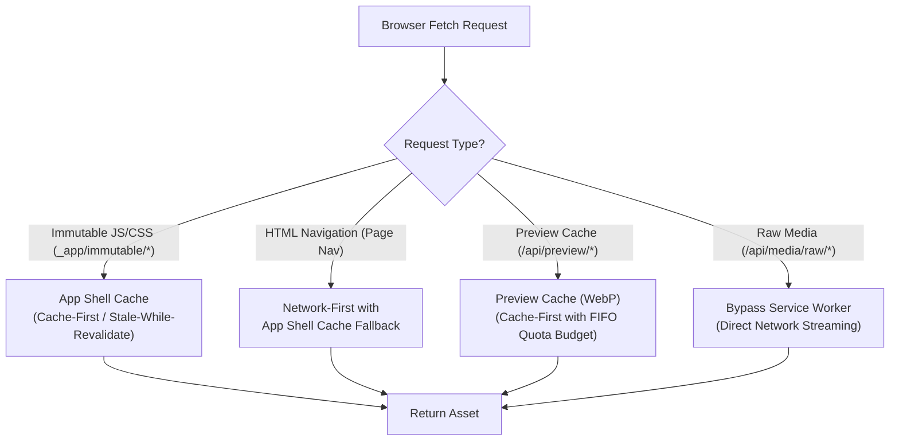
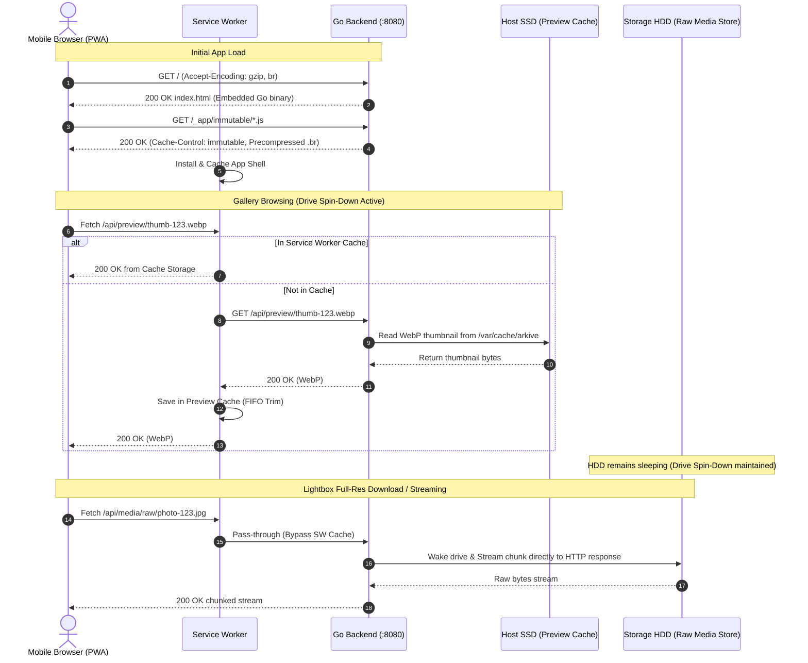

# Research 03: Frontend Architecture & Single-Binary PWA Delivery

**Ticket**: [03-frontend-pwa-architecture.md](file:///home/adrian/adrian-dev/arkive/.scratch/arkive/issues/03-frontend-pwa-architecture.md)  
**Status**: Resolved  
**Scope**: Single-Binary Distribution, Mobile Gallery Performance & Virtualization, PWA & Offline Asset Caching, Touch Lightbox & Inline Media Playback, and Concrete Recommendation for Arkive.

---

## Executive Summary

Arkive is designed to run efficiently on low-spec host hardware (Intel Pentium Dual-Core E5400, <100MB idle RAM, 2-tier SSD/HDD storage) while delivering an app-like, 60fps mobile Progressive Web Application (PWA) to authenticated **Uploaders** and public/restricted **Viewers**.

This research establishes four architectural pillars for Arkive's client delivery:
1. **Zero-Node Serverless Distribution**: SvelteKit is compiled into a static Single-Page Application (SPA) using `@sveltejs/adapter-static` with precompression (`.gz` and `.br`). The entire artifact tree is compiled directly into the Go backend binary using Go 1.16+ `//go:embed all:build`. An intelligent Go `http.Handler` serves immutable hashed assets with year-long cache lifetimes while routing non-asset routes to `index.html` (HTTP 200) for client-side routing.
2. **Deterministic Uniform-Row Virtualization**: Scrolling through galleries containing 10,000+ items on budget mobile devices fails if unvirtualized due to bitmap texture memory consumption ($W \times H \times 4$ bytes per decoded image). CSS `content-visibility: auto` skips layout/paint but retains decoded textures in memory. A lightweight mathematical uniform-row windowing virtualizer in Svelte 5 renders only the visible rows plus an overscan buffer ($\approx 60$ total `` DOM nodes), keeping mobile RAM under 40MB and maintaining 60fps scroll performance.
3. **Budget-Capped Dual-Tier Service Worker**: Leveraging SvelteKit’s native `src/service-worker.ts`, the PWA maintains a version-pinned App Shell cache (precached on install, purged on activate) and a dedicated 50MB / 500-entry budget-limited **Preview Cache** for thumbnails. This uses FIFO eviction via `Cache.keys()` order (guaranteed insertion order per W3C specification) to prevent mobile quota exhaustion while insulating the backend **Drive Spin-Down** state from repeat browsing.
4. **On-Demand Dynamic Lightbox with Decoder Cleanup**: Media viewing is powered by PhotoSwipe v5 (~16.6 kB gzipped, 0 dependencies) loaded via dynamic `import()` only when an item is tapped. Touch gestures (pinch-to-zoom, pan, swipe-to-dismiss) run on hardware-accelerated CSS transforms. For videos, `playsinline` and strict lifecycle cleanup (`video.src = ""`) prevent mobile hardware video decoder exhaustion.

---

## 1. Single-Binary Packaging: SvelteKit Static SPA + Go `embed.FS`

### 1.1 SvelteKit SPA Configuration with `@sveltejs/adapter-static`

SvelteKit's `@sveltejs/adapter-static` allows an application to be prerendered as static files. To support dynamic data loading from Go REST APIs, client-side authentication, and parameterized routing (such as `/albums/[id]` or `/shares/[token]`), SvelteKit must be configured in Single-Page Application (SPA) mode with a designated fallback page.

In SvelteKit, SPA mode is enabled by:
1. Setting `fallback: 'index.html'` in the adapter configuration in `vite.config.ts`.
2. Setting `ssr = false` and `prerender = false` in the root layout (`src/routes/+layout.ts`).

```typescript
// vite.config.ts
import { sveltekit } from '@sveltejs/kit/vite';
import adapter from '@sveltejs/adapter-static';
import { defineConfig } from 'vite';

export default defineConfig({
  plugins: [
    sveltekit({
      adapter: adapter({
        pages: 'build',
        assets: 'build',
        fallback: 'index.html', // Emits fallback SPA shell
        precompress: true,      // Generates .gz and .br precompressed files at build time
        strict: true
      })
    })
  ]
});
```

```typescript
// src/routes/+layout.ts
// Disable server-side rendering for pure SPA operation
export const ssr = false;
export const prerender = false;
export const trailingSlash = 'never';
```

When `vite build` executes, SvelteKit generates the following directory structure inside `build/`:
```text
build/
├── _app/
│   ├── immutable/
│   │   ├── assets/
│   │   │   └── [name].[hash].css
│   │   ├── chunks/
│   │   │   └── [name].[hash].js
│   │   ├── entry/
│   │   │   ├── app.[hash].js
│   │   │   └── start.[hash].js
│   │   └── nodes/
│   │       └── [id].[hash].js
│   └── version.json
├── favicon.png
├── index.html
├── manifest.webmanifest
└── service-worker.js
```

### 1.2 The Go `embed.FS` Mechanism & The Crucial `all:` Prefix

The Go standard library `embed` package (introduced in Go 1.16) embeds files into the compiled binary. However, **by default, Go's `//go:embed` wildcard pattern ignores files and directories that begin with a dot (`.`) or an underscore (`_`)**. 

Because SvelteKit outputs its hashed immutable bundles into the `_app/` directory, a standard directive like `//go:embed build/*` will silently omit the entire `_app/` hierarchy, causing 404 errors for all JavaScript and CSS files.

To include directories with leading underscores, Go 1.16+ / Go 1.18 requires the `all:` prefix:

```go
package web

import (
	"embed"
	"io/fs"
)

//go:embed all:build
var EmbeddedFS embed.FS

// GetFileSystem returns the rooted sub-filesystem for the embedded web assets
func GetFileSystem() (fs.FS, error) {
	return fs.Sub(EmbeddedFS, "build")
}
```

### 1.3 Production-Grade Go HTTP Handler with SPA Fallback & Precompression

Standard `http.FileServer` returns an HTTP 404 Not Found if a requested path does not map to a physical file on disk. In a client-side SPA, direct navigations or page refreshes on deep URLs (e.g. `/albums/vacation-2026` or `/shares/xyz789`) must serve `index.html` with an HTTP 200 OK status so SvelteKit’s client-side router can mount and initialize the route.

Furthermore, on Arkive’s low-power host (Pentium E5400, 2 cores), on-the-fly Gzip/Brotli compression consumes valuable CPU cycles. By enabling `precompress: true` in `@sveltejs/adapter-static`, Vite generates `.gz` and `.br` files ahead of time during the frontend build. The Go HTTP handler inspects `Accept-Encoding`, serving the precompressed static byte stream with zero runtime compression overhead.

```go
package web

import (
	"errors"
	"io"
	"io/fs"
	"mime"
	"net/http"
	"path"
	"path/filepath"
	"strings"
)

type SPAHandler struct {
	fileSystem fs.FS
	indexHTML  []byte
}

func NewSPAHandler(embeddedFS fs.FS) (*SPAHandler, error) {
	sub, err := fs.Sub(embeddedFS, "build")
	if err != nil {
		return nil, err
	}

	indexFile, err := sub.Open("index.html")
	if err != nil {
		return nil, err
	}
	defer indexFile.Close()

	indexData, err := io.ReadAll(indexFile)
	if err != nil {
		return nil, err
	}

	return &SPAHandler{
		fileSystem: sub,
		indexHTML:  indexData,
	}, nil
}

func (h *SPAHandler) ServeHTTP(w http.ResponseWriter, r *http.Request) {
	// Clean the requested path
	upath := path.Clean(r.URL.Path)
	if upath == "/" || upath == "." {
		h.serveIndex(w)
		return
	}

	trimmedPath := strings.TrimPrefix(upath, "/")

	// Check if file exists in the embedded filesystem
	fileInfo, err := fs.Stat(h.fileSystem, trimmedPath)
	if err == nil && !fileInfo.IsDir() {
		// Serve static file with caching and precompression support
		h.serveStaticFile(w, r, trimmedPath)
		return
	}

	// If the request points to an asset path that is missing, return 404
	if strings.HasPrefix(trimmedPath, "_app/") || strings.HasPrefix(trimmedPath, "static/") {
		http.NotFound(w, r)
		return
	}

	// SPA Fallback: Serve index.html for client-side routing
	h.serveIndex(w)
}

func (h *SPAHandler) serveIndex(w http.ResponseWriter) {
	w.Header().Set("Content-Type", "text/html; charset=utf-8")
	// Index must not be cached aggressively so new deployments are fetched immediately
	w.Header().Set("Cache-Control", "no-cache, no-store, must-revalidate")
	w.WriteHeader(http.StatusOK)
	_, _ = w.Write(h.indexHTML)
}

func (h *SPAHandler) serveStaticFile(w http.ResponseWriter, r *http.Request, filePath string) {
	// 1. Cache-Control Header Strategy
	if strings.HasPrefix(filePath, "_app/immutable/") {
		// SvelteKit hashed assets are immutable forever
		w.Header().Set("Cache-Control", "public, max-age=31536000, immutable")
	} else if filePath == "service-worker.js" {
		// Service workers must be checked regularly
		w.Header().Set("Cache-Control", "no-cache, no-store, must-revalidate")
	} else {
		// General static assets (icons, manifest)
		w.Header().Set("Cache-Control", "public, max-age=86400")
	}

	// 2. MIME type detection
	ext := filepath.Ext(filePath)
	mimeType := mime.TypeByExtension(ext)
	if mimeType != "" {
		w.Header().Set("Content-Type", mimeType)
	}

	// 3. Precompressed delivery (.br or .gz)
	acceptEncoding := r.Header.Get("Accept-Encoding")
	if strings.Contains(acceptEncoding, "br") {
		if brFile, err := h.fileSystem.Open(filePath + ".br"); err == nil {
			defer brFile.Close()
			w.Header().Set("Content-Encoding", "br")
			w.Header().Add("Vary", "Accept-Encoding")
			_, _ = io.Copy(w, brFile)
			return
		}
	} else if strings.Contains(acceptEncoding, "gzip") {
		if gzFile, err := h.fileSystem.Open(filePath + ".gz"); err == nil {
			defer gzFile.Close()
			w.Header().Set("Content-Encoding", "gzip")
			w.Header().Add("Vary", "Accept-Encoding")
			_, _ = io.Copy(w, gzFile)
			return
		}
	}

	// 4. Uncompressed fallback
	file, err := h.fileSystem.Open(filePath)
	if err != nil {
		http.NotFound(w, r)
		return
	}
	defer file.Close()

	_, _ = io.Copy(w, file)
}
```

### 1.4 Cache-Control Header Invariants

| Path Pattern | Cache-Control Value | Rationale |
| :--- | :--- | :--- |
| `_app/immutable/*` | `public, max-age=31536000, immutable` | Unique hash in filename. Guaranteed never to change. |
| `index.html` | `no-cache, must-revalidate` | Contains references to current entry scripts. Must revalidate on deployment. |
| `service-worker.js` | `no-cache, must-revalidate` | Enforces browser byte-check on navigation. |
| `manifest.webmanifest`, `favicon.png` | `public, max-age=86400` | Re-fetchable daily. |

---

## 2. Mobile Gallery Performance & DOM Virtualization

### 2.1 The Mobile Bottleneck: DOM Nodes vs Decoded Texture Memory (VRAM)

When rendering large photo/video galleries (e.g. 5,000 to 20,000 media items), there are two distinct failure modes on mobile devices:
1. **DOM Tree Bloat**: Having >3,000 DOM nodes degrades browser hit testing, recalculation of style trees, and frame dispatch, causing scroll stutter below 30fps.
2. **Decoded Image Texture Memory (RAM/VRAM Exhaustion)**: When an `` tag loads an image, the browser downloads the compressed byte stream (e.g. 30 KB WebP) and decodes it into an uncompressed RGBA bitmap texture in memory:
   $$\text{Texture Memory} = \text{Width} \times \text{Height} \times 4\text{ bytes}$$
   A single $400 \times 400$ thumbnail consumes:
   $$400 \times 400 \times 4\text{ B} = 640\text{ KB of RAM}$$
   If 1,000 unvirtualized thumbnails remain in the DOM, they consume **640 MB of RAM** purely in bitmap textures. On budget Android devices (2GB RAM) or older iPhones, this exceeds the WebKit/Blink tab memory threshold, leading to sudden **OOM tab crashes** or white screens.

### 2.2 Why CSS `content-visibility: auto` is Insufficient on Mobile

CSS `content-visibility: auto` instructs the browser rendering engine to skip layout, style calculation, and painting for elements outside the viewport. 

While `content-visibility: auto` drastically reduces layout CPU cost on desktop, **it does not solve mobile memory exhaustion**:
- **Images remain decoded in memory**: The browser retains the DOM tree and cached decoded bitmap textures in memory even when elements are skipped.
- **Scrollbar instability (Layout Shifts)**: Unless every element has an exact `contain-intrinsic-size` matching its measured height, rapid scrolling causes cumulative layout shifts (CLS) and erratic scroll jumps.
- **Network requests continue**: Offscreen standard `` tags continue downloading unless paired with `loading="lazy"`.

**Conclusion**: For 1,000+ photos on mobile, **true DOM windowing (virtual scrolling)** is mandatory. Off-screen elements must be completely unmounted from the DOM to force the browser engine to release bitmap texture memory.

### 2.3 Virtualization Architecture: Uniform Row-Based Windowing

Photo galleries on mobile devices naturally present as multi-column grids (typically 3 columns on smartphones, 4-6 on tablets):
- Instead of measuring every individual thumbnail (which causes layout thrashing), the gallery layout is standardized to **uniform square aspect-ratio rows** (`aspect-ratio: 1 / 1`).
- Because all items in a row share the same width and height, the vertical position of row $i$ is calculated mathematically in $O(1)$ time without reading the DOM:
  $$\text{Item Width} = \frac{\text{Viewport Width} - (\text{Columns} - 1) \times \text{Gap}}{\text{Columns}}$$
  $$\text{Row Height} = \text{Item Width}$$
  $$\text{Total Rows} = \left\lceil \frac{N}{\text{Columns}} \right\rceil$$
  $$\text{Total Height} = \text{Total Rows} \times (\text{Row Height} + \text{Gap}) - \text{Gap}$$

Given the current `scrollTop`, the range of visible rows is strictly:
$$\text{Start Row} = \max\left(0, \left\lfloor \frac{\text{scrollTop}}{\text{Row Height} + \text{Gap}} \right\rfloor - \text{Overscan}\right)$$
$$\text{End Row} = \min\left(\text{Total Rows} - 1, \left\lceil \frac{\text{scrollTop} + \text{Viewport Height}}{\text{Row Height} + \text{Gap}} \right\rceil + \text{Overscan}\right)$$

With an overscan buffer of 3 rows above and 3 rows below:
- Visible rows on screen: $\approx 5$ to 6 rows.
- Total mounted rows: $\approx 12$ rows.
- At 3 columns: **only 36 `` elements exist in the DOM at any given moment**, regardless of whether the gallery contains 100 or 100,000 photos!
- Total bitmap texture memory is capped at $\approx 23\text{ MB}$, well below mobile device thresholds.

### 2.4 Virtualization Approach Comparison

| Metric / Capability | Approach A: `@tanstack/svelte-virtual` | Approach B: Bespoke Svelte 5 Virtual Grid |
| :--- | :--- | :--- |
| **Gzipped Bundle Size** | ~7.5 kB | ~1.5 kB (Zero dependencies) |
| **Dependencies** | `@tanstack/virtual-core` | None |
| **Layout Model** | Dynamic measuring + Fixed rows | Pure mathematical uniform rows |
| **Date Header Support** | Dynamic size estimation | Chunked date-section headers |
| **Svelte 5 Runes Native** | Yes (`createVirtualizer`) | Yes (`$state`, `$derived`, `$effect`) |
| **Recommendation** | Excellent for complex variable layouts | **Preferred for Arkive**: Lowest bundle, zero overhead |

### 2.5 Image Decoding & Memory Lifecycle

Inside the virtualized row, thumbnail elements must adhere to these attributes:
1. `loading="lazy"`: Prevents eager fetching if rows mount during rapid momentum flick scrolling.
2. `decoding="async"`: Ensures image decoding runs off the main browser thread, avoiding 16.6ms frame drops.
3. `aspect-ratio: 1 / 1` and `background-color: var(--color-placeholder)`: Reserves space instantly to prevent layout shifts before the image arrives.
4. **Immediate unmount on scroll**: When a row leaves the visible + overscan window, Svelte unmounts the component. WebKit and Blink garbage-collect the unreferenced bitmap textures within milliseconds.

---

## 3. Service Worker PWA Caching & Quota Management

### 3.1 SvelteKit Native Service Worker Lifecycle

SvelteKit provides built-in support for service workers via `src/service-worker.ts`. During compilation, SvelteKit injects modules providing exact manifests of the build:
- `$app/service-worker`: Provides the typed `self: ServiceWorkerGlobalScope`.
- `$app/env`: Provides `version` (matches the build timestamp or Git commit hash).
- `$app/manifest`: Provides `immutable` (all hashed JavaScript and CSS files) and `assets` (static files from the `static/` folder).

When a new version of Arkive is deployed:
1. The browser detects byte changes in `service-worker.js`.
2. The `install` event triggers: new immutable assets are fetched and saved in `cache-${version}`.
3. The `activate` event triggers: old caches matching `cache-*` from previous versions are purged.

### 3.2 Tiered Caching Strategy (App Shell vs Preview Cache)

Arkive must distinguish between static application code and dynamic media content:



1. **App Shell Cache (`arkive-shell-v{version}`)**:
   - Contains: `index.html`, `_app/immutable/*`, icons, manifest.
   - Strategy: Cache-First. Updated atomically on deployment.
2. **Preview Cache (`arkive-previews-v1`)**:
   - Contains: Lightweight WebP thumbnails (15-30 KB each) and video keyframes served from the host SSD.
   - Strategy: Cache-First with strict quota eviction.
3. **Raw Media Store (`/api/media/raw/*`)**:
   - Contains: Original full-resolution media files from the secondary storage volume (`/mnt/storage`).
   - Strategy: **Network-only (bypasses Cache Storage)**. Caching 50MB-1GB video files or 24MP RAW photos in browser Cache Storage would immediately crash client quota limits.

### 3.3 Storage Quota Management & Eviction Strategy

Mobile browsers allocate origin storage dynamically based on free device space:
- Modern Android Chrome: Allocates up to 60% of disk space.
- iOS Safari: Limits non-installed web apps to 500MB - 1GB, and will evict non-persisted origins if untouched for 7 days.
- Low-end devices with 16GB total storage may have less than 200MB free.

If a **Viewer** scrolls through a shared wedding or event album with 5,000 photos, downloading thumbnails without an eviction policy would store $5,000 \times 25\text{ KB} = 125\text{ MB}$, triggering `QuotaExceededError`.

#### FIFO Eviction via W3C `Cache.keys()` Order

Under the [W3C Service Worker Cache Storage Specification](https://w3c.github.io/ServiceWorker/#dom-cache-keys), the `keys()` method returns an array of `Request` objects in the **exact insertion order** in which they were added.

This allows implementing a **zero-dependency FIFO (First-In-First-Out) cache pruning algorithm** without requiring an IndexedDB database for timestamp tracking:

```typescript
// src/service-worker.ts
const MAX_PREVIEW_ENTRIES = 500; // Cap at 500 thumbnails (~12.5 MB)

async function trimCache(cacheName: string, maxItems: number) {
  const cache = await caches.open(cacheName);
  const keys = await cache.keys();
  if (keys.length > maxItems) {
    // Delete the oldest entries (head of array)
    const countToDelete = keys.length - maxItems;
    const deletes = keys.slice(0, countToDelete).map(key => cache.delete(key));
    await Promise.all(deletes);
  }
}
```

Whenever a new thumbnail is cached in the background, `trimCache` is scheduled via `event.waitUntil()`, ensuring the cache stays bounded.

### 3.4 Drive Spin-Down Insulation via Client-Side Caching

In Arkive's storage architecture, the **Preview Cache** on the host SSD protects the secondary hard drive (`/mnt/storage`) from waking up during gallery browsing. 

Client-side PWA caching takes this a step further: by caching the most recent 500 thumbnails directly in the client's browser Cache Storage, repeated navigation between folders or re-opening the PWA executes with **zero network requests to the server**, keeping host CPU at 0% and avoiding all disk I/O.

---

## 4. Touch Gestures & Lightbox Media Viewer

### 4.1 Viewer Interaction Requirements

When a user taps an item in the gallery, the mobile PWA must open a fullscreen lightbox viewer that delivers native-feeling gestures:
- **Horizontal Swipe**: Smooth transition between adjacent photos/videos with drag tracking.
- **Pinch-to-Zoom**: Fluid multi-touch scaling with boundary panning and rubber-band rebound.
- **Swipe-to-Dismiss**: Dragging down/up shrinks the image and fades the backdrop to exit.
- **Inline HTML5 Video Playback**: Immediate playback of videos without forcing the OS to hijack the screen into a native fullscreen player.

### 4.2 Architectural Tradeoffs: Vanilla Pointer Events vs Dedicated Lightbox

| Evaluation Criteria | Vanilla Pointer Events Implementation | PhotoSwipe v5 (`photoswipe`) |
| :--- | :--- | :--- |
| **Gzipped Size** | ~3 to 5 kB (bespoke) | **~16.6 kB** (Modular ES build) |
| **Dependencies** | 0 | **0 (Zero dependencies)** |
| **Gesture Physics** | Custom math (momentum, spring physics, pinch-zoom center calculations prone to edge-case bugs) | Battle-tested, native-feeling spring physics, deceleration, multi-touch pinch-zoom |
| **Cross-Platform Touch Edge Cases** | High risk (iOS Safari gesture conflicts, Android pointer cancel, pointer capture quirks) | Handles Safari address bar collapse, notch safe areas, dual pointer cancellation |
| **Inline Video Integration** | Bespoke video container management | Direct HTML content slides or `photoswipe-video-plugin` |
| **Code Splitting** | Bundled in main page | **Loaded on-demand** via dynamic `import()` on tap |

**Decision**: Implementing multi-touch pinch-to-zoom matrix transformations and swipe momentum from scratch requires hundreds of lines of complex math that is notoriously brittle across iOS WebKit and Android Chrome. **PhotoSwipe v5** is the industry standard: it has 0 dependencies, weighs only 16.6 kB gzipped, and can be dynamically imported so it costs **0 KB on initial gallery load**.

### 4.3 PhotoSwipe v5 On-Demand Loading Pattern

PhotoSwipe v5 is split into two modules:
1. `PhotoSwipeLightbox`: Lightweight trigger coordinator (~4 kB gzipped).
2. `PhotoSwipe`: Core gesture and rendering engine (~12 kB gzipped), dynamically imported only when user activates a slide.

```typescript
// Svelte 5 component action
import PhotoSwipeLightbox from 'photoswipe/lightbox';
import 'photoswipe/style.css';

export function createGalleryLightbox(galleryElement: HTMLElement) {
  const lightbox = new PhotoSwipeLightbox({
    gallery: galleryElement,
    children: 'a.gallery-item',
    pswpModule: () => import('photoswipe'), // Dynamic import on first click
    bgOpacity: 0.95,
    showHideAnimationType: 'zoom',
    pinchToClose: true,
    closeOnVerticalDrag: true,
  });

  lightbox.init();
  return lightbox;
}
```

### 4.4 Mobile Inline HTML5 Video Playback & Hardware Decoder Management

To achieve smooth inline video playback inside the lightbox on mobile:

1. **Prevent Native Fullscreen Takeover**: iOS Safari will hijack any `<video>` element into its native fullscreen player unless `playsinline` and `webkit-playsinline` are present.
2. **Audio Autoplay Policies**: Mobile browsers block unmuted autoplay unless explicitly initiated by a user gesture. Videos should start `muted` with explicit user controls available:
   ```html
   <video 
     src="/api/media/stream/[id]" 
     controls 
     playsinline 
     webkit-playsinline 
     preload="metadata"
     poster="/api/preview/[id]?size=large">
   </video>
   ```
3. **Hardware Video Decoder Cleanup**:
   Mobile SoCs feature a limited number of hardware video decoders (often only 2 to 4 simultaneous instances). If a user swipes through 10 videos in a lightbox and `<video>` elements remain attached or buffered in the DOM, subsequent videos will fail with decoding errors or freeze the browser.

   **Invariant**: When a video slide is deactivated or swiped away in PhotoSwipe, its playback must be paused and its source cleared:
   ```javascript
   lightbox.on('change', () => {
     // Pause and release any previous video elements
     document.querySelectorAll('.pswp video').forEach((video) => {
       video.pause();
       video.removeAttribute('src'); // Releases hardware decoder buffer
       video.load();
     });
   });
   ```

---

## 5. Concrete Architectural Blueprint for Arkive

### 5.1 System Architecture Flow



### 5.2 Implementation: Svelte 5 Uniform-Row Virtual Grid

This component uses Svelte 5 Runes to provide $O(1)$ uniform-row virtualization, keeping DOM elements capped at $\approx 40$ items regardless of gallery size:

```svelte
<!-- src/lib/components/VirtualGallery.svelte -->
<script lang="ts">
  import { onMount } from 'svelte';

  interface MediaItem {
    id: string;
    filename: string;
    width: number;
    height: number;
    isVideo: boolean;
  }

  interface Props {
    items: MediaItem[];
    columns?: number;
    gap?: number;
    overscan?: number;
    onSelect: (index: number) => void;
  }

  let { items, columns = 3, gap = 4, overscan = 3, onSelect }: Props = $props();

  let containerElement = $state<HTMLElement | null>(null);
  let containerWidth = $state(0);
  let scrollTop = $state(0);
  let viewportHeight = $state(0);

  // Derived dimensions
  let itemWidth = $derived(
    columns > 0 ? (containerWidth - (columns - 1) * gap) / columns : 0
  );
  let rowHeight = $derived(itemWidth); // Uniform 1:1 aspect ratio
  let totalRows = $derived(Math.ceil(items.length / columns));
  let totalHeight = $derived(
    totalRows > 0 ? totalRows * (rowHeight + gap) - gap : 0
  );

  // Calculate visible row slice
  let startRow = $derived(
    rowHeight > 0
      ? Math.max(0, Math.floor(scrollTop / (rowHeight + gap)) - overscan)
      : 0
  );
  let endRow = $derived(
    rowHeight > 0
      ? Math.min(
          totalRows - 1,
          Math.ceil((scrollTop + viewportHeight) / (rowHeight + gap)) + overscan
        )
      : 0
  );

  // Extract visible rows data
  let visibleRows = $derived.by(() => {
    if (items.length === 0 || rowHeight <= 0) return [];
    const rows = [];
    for (let r = startRow; r <= endRow; r++) {
      const startIndex = r * columns;
      const rowItems = items.slice(startIndex, startIndex + columns);
      rows.push({
        rowIndex: r,
        topOffset: r * (rowHeight + gap),
        items: rowItems,
        startIndex,
      });
    }
    return rows;
  });

  function handleScroll(e: Event) {
    const target = e.currentTarget as HTMLElement;
    scrollTop = target.scrollTop;
  }

  function handleResize() {
    if (containerElement) {
      containerWidth = containerElement.clientWidth;
      viewportHeight = containerElement.clientHeight;
    }
  }

  onMount(() => {
    handleResize();
    window.addEventListener('resize', handleResize);
    return () => window.removeEventListener('resize', handleResize);
  });
</script>

<div
  bind:this={containerElement}
  class="virtual-scroll-container"
  onscroll={handleScroll}
>
  <div class="virtual-phantom-spacer" style="height: {totalHeight}px;">
    {#each visibleRows as row (row.rowIndex)}
      <div
        class="virtual-row"
        style="
          transform: translateY({row.topOffset}px);
          height: {rowHeight}px;
          gap: {gap}px;
        "
      >
        {#each row.items as item, colIndex}
          {@const itemIndex = row.startIndex + colIndex}
          <button
            type="button"
            class="gallery-thumbnail-card"
            style="width: {itemWidth}px; height: {rowHeight}px;"
            onclick={() => onSelect(itemIndex)}
          >
            
            {#if item.isVideo}
              <div class="video-indicator-badge" aria-hidden="true">▶</div>
            {/if}
          </button>
        {/each}
      </div>
    {/each}
  </div>
</div>

<style>
  .virtual-scroll-container {
    width: 100%;
    height: 100%;
    overflow-y: auto;
    overflow-x: hidden;
    position: relative;
    -webkit-overflow-scrolling: touch;
  }

  .virtual-phantom-spacer {
    width: 100%;
    position: relative;
  }

  .virtual-row {
    position: absolute;
    top: 0;
    left: 0;
    width: 100%;
    display: flex;
    will-change: transform;
  }

  .gallery-thumbnail-card {
    position: relative;
    padding: 0;
    border: none;
    background: #1a1a1a;
    overflow: hidden;
    cursor: pointer;
  }

  .thumbnail-img {
    width: 100%;
    height: 100%;
    object-fit: cover;
    display: block;
  }

  .video-indicator-badge {
    position: absolute;
    bottom: 6px;
    right: 6px;
    background: rgba(0, 0, 0, 0.7);
    color: #fff;
    font-size: 10px;
    padding: 2px 5px;
    border-radius: 3px;
  }
</style>
```

### 5.3 Implementation: SvelteKit Service Worker with FIFO Eviction

```typescript
// src/service-worker.ts
/// <reference types="@sveltejs/kit" />
import { self } from '$app/service-worker';
import { version } from '$app/env';
import { immutable, assets } from '$app/manifest';

const SHELL_CACHE = `arkive-shell-v${version}`;
const PREVIEW_CACHE = 'arkive-preview-v1';
const MAX_PREVIEW_ENTRIES = 500; // Cap client thumbnails to ~12.5MB

// Static assets to precache
const PRECACHE_ASSETS = [
  '/',
  ...immutable.map((asset) => asset.path),
  ...assets.map((asset) => asset.path),
];

self.addEventListener('install', (event) => {
  event.waitUntil(
    caches.open(SHELL_CACHE).then((cache) => cache.addAll(PRECACHE_ASSETS))
  );
  self.skipWaiting();
});

self.addEventListener('activate', (event) => {
  event.waitUntil(
    caches.keys().then(async (keys) => {
      for (const key of keys) {
        // Delete older shell caches
        if (key.startsWith('arkive-shell-') && key !== SHELL_CACHE) {
          await caches.delete(key);
        }
      }
    })
  );
  self.clients.claim();
});

self.addEventListener('fetch', (event) => {
  const url = new URL(event.request.url);

  // 1. Raw media streams bypass cache storage (direct from storage HDD)
  if (url.pathname.startsWith('/api/media/raw/')) {
    return;
  }

  // 2. Thumbnails & video keyframes: Cache-First with FIFO Quota Eviction
  if (url.pathname.startsWith('/api/preview/')) {
    event.respondWith(
      caches.open(PREVIEW_CACHE).then(async (cache) => {
        const cachedResponse = await cache.match(event.request);
        if (cachedResponse) {
          return cachedResponse;
        }

        const networkResponse = await fetch(event.request);
        if (networkResponse.ok) {
          // Clone and store in cache
          await cache.put(event.request, networkResponse.clone());
          // Schedule background FIFO trimming
          event.waitUntil(trimCache(PREVIEW_CACHE, MAX_PREVIEW_ENTRIES));
        }
        return networkResponse;
      })
    );
    return;
  }

  // 3. Immutable hashed assets: Cache-First
  if (url.pathname.startsWith('/_app/immutable/')) {
    event.respondWith(
      caches.match(event.request).then((res) => res || fetch(event.request))
    );
    return;
  }

  // 4. HTML Navigation: Network-First with Shell Fallback
  if (event.request.mode === 'navigate') {
    event.respondWith(
      fetch(event.request).catch(async () => {
        const cache = await caches.open(SHELL_CACHE);
        return cache.match('/') as Promise<Response>;
      })
    );
    return;
  }

  // Default: Stale-While-Revalidate for app static assets
  event.respondWith(
    caches.match(event.request).then((cached) => {
      const fetchPromise = fetch(event.request).then(async (networkRes) => {
        if (networkRes.ok) {
          const cache = await caches.open(SHELL_CACHE);
          cache.put(event.request, networkRes.clone());
        }
        return networkRes;
      });
      return cached || fetchPromise;
    })
  );
});

// Trim cache using insertion-order guarantees from W3C Cache.keys()
async function trimCache(cacheName: string, maxItems: number) {
  try {
    const cache = await caches.open(cacheName);
    const keys = await cache.keys();
    if (keys.length > maxItems) {
      const itemsToDelete = keys.slice(0, keys.length - maxItems);
      await Promise.all(itemsToDelete.map((key) => cache.delete(key)));
    }
  } catch (err) {
    console.warn('Cache trim failed:', err);
  }
}
```

---

## 6. Primary Source Citations & References

1. **SvelteKit Single-Page Apps (SPA Mode)**:
   - SvelteKit Documentation: *Single-page apps*  
     https://svelte.dev/docs/kit/single-page-apps
   - SvelteKit Documentation: `@sveltejs/adapter-static`  
     https://svelte.dev/docs/kit/adapter-static
2. **Go `embed` Package & Filesystem Subtrees**:
   - The Go Programming Language Specification: `package embed` (details on `all:` directive for files with leading dots and underscores)  
     https://pkg.go.dev/embed
   - Go Standard Library: `io/fs` (Sub, Stat, Open)  
     https://pkg.go.dev/io/fs
   - Go Standard Library: `net/http` (FileServer, ServeContent)  
     https://pkg.go.dev/net/http
3. **Service Worker Cache API & Quotas**:
   - W3C Recommendation: *Service Workers 1* (Specifies `Cache.keys()` insertion ordering)  
     https://www.w3.org/TR/service-workers/#dom-cache-keys
   - MDN Web Docs: *StorageManager.estimate()*  
     https://developer.mozilla.org/en-US/docs/Web/API/StorageManager/estimate
   - MDN Web Docs: *CacheStorage API*  
     https://developer.mozilla.org/en-US/docs/Web/API/CacheStorage
4. **CSS Containment & Viewport Rendering**:
   - MDN Web Docs: *content-visibility*  
     https://developer.mozilla.org/en-US/docs/Web/CSS/content-visibility
   - W3C CSS Containment Module Level 2  
     https://www.w3.org/TR/css-contain-2/
5. **PhotoSwipe Lightbox & Mobile Video**:
   - PhotoSwipe v5 Documentation & Architecture (Zero-dependency modular core)  
     https://photoswipe.com/
   - MDN Web Docs: *The HTML Video element* (`playsinline`, `preload`)  
     https://developer.mozilla.org/en-US/docs/Web/HTML/Element/video#playsinline
